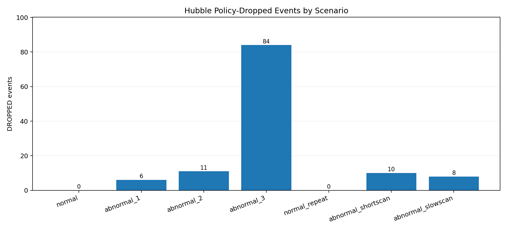
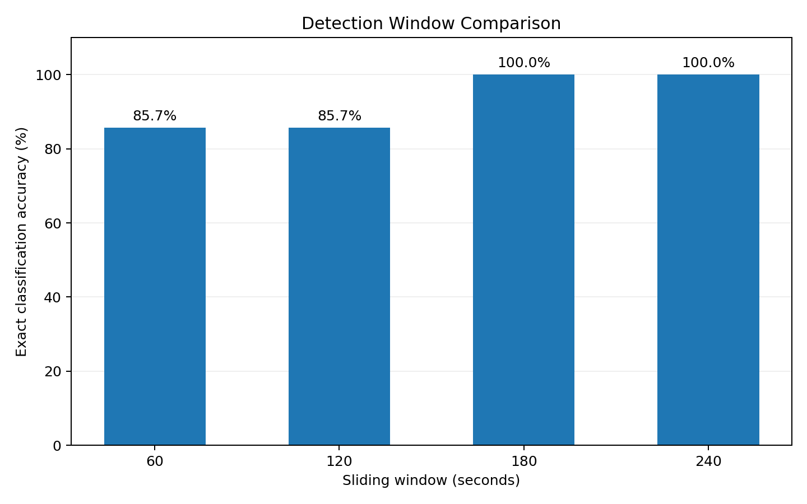
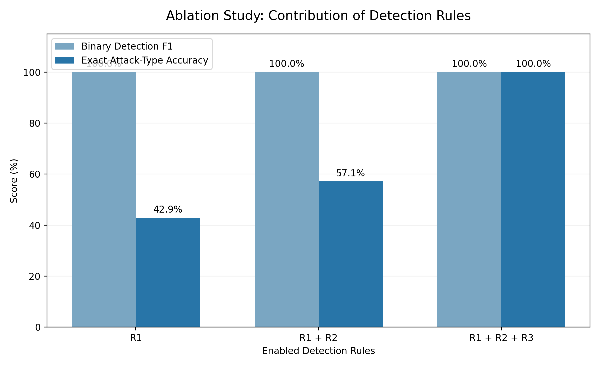

# Policy-Aware Kubernetes Network Anomaly Detection

**Practical Cloud Security PBL — Category 2**

Kubernetes 환경에서 Cilium Hubble 로그를 활용하여 비인가 통신, 내부 네트워크 탐색, 포트 스캔을 탐지하는 규칙 기반 시스템입니다.

## 1. Project Overview

Kubernetes NetworkPolicy는 비인가 통신을 차단합니다.
본 프로젝트는 Hubble 이벤트를 분석해 차단된 통신의 목적지와 포트 패턴을 식별하고 공격 유형을 분류합니다.

### Detection Rules

| Rule | Detection |
|------|-----------|
| R1 | Unauthorized Egress |
| R2 | Destination Fan-out |
| R3 | Multi-Port Scanning |

기본 탐지 윈도우는 180초입니다.

## 2. System Architecture

Hubble JSONL → Parser → Normalizer → Detector (R1/R2/R3) → Evaluation & Visualization

### Source Files

- `src/parser.py`: Hubble JSON 파싱
- `src/normalizer.py`: TCP 연결 시도 정규화
- `src/detector.py`: 네트워크 이상 탐지
- `src/evaluate.py`: 탐지 성능 평가
- `src/ablation.py`: 탐지 규칙별 비교
- `src/visualize.py`: 실험 결과 시각화
- `src/plot_ablation.py`: Ablation 그래프

## 3. Experimental Environment

- Kubernetes: kind, 3 nodes
- Cilium / Hubble: v1.16.3
- Workloads: Frontend, Backend, DB
- Python 3
- Seven normal and attack scenarios

## 4. Experimental Results

### Scenario Classification

| Scenario | Prediction |
|----------|------------|
| Normal | NORMAL |
| Abnormal 1 | UNAUTHORIZED_EGRESS |
| Abnormal 2 | DESTINATION_FANOUT |
| Abnormal 3 | MULTI_PORT_SCAN |
| Normal Repeat | NORMAL |
| Short Port Scan | MULTI_PORT_SCAN |
| Slow Port Scan | MULTI_PORT_SCAN |

### Ablation Study

| Configuration | Binary F1 | Type Accuracy |
|---------------|-----------|---------------|
| R1 | 1.000 | 42.9% |
| R1 + R2 | 1.000 | 57.1% |
| R1 + R2 + R3 | 1.000 | 100.0% |

### Sliding Window Comparison

| Window | Exact Classification Accuracy |
|--------|-------------------------------|
| 60s | 85.7% |
| 120s | 85.7% |
| 180s | 100.0% |
| 240s | 100.0% |

위 결과는 규칙 개발에 사용된 7개 시나리오 기준으로, 독립적인 일반화 성능을 의미하지 않습니다.

## 5. Visualizations

### Hubble Dropped Events

### Detection Window Comparison

### Ablation Study

## 6. Reproduction

Python dependencies:

`python3 -m pip install -r requirements.txt`

실험에 사용한 Hubble 원본 JSONL 로그 7개가 `results/raw/`에 있어야 오프라인 분석을 실행할 수 있습니다.

실행 명령:

`bash scripts/reproduce.sh`

원본 로그는 내부 네트워크 정보를 포함하므로 공개 저장소에서 제외합니다.

## 7. Limitations

- 현재 평가 데이터는 제한된 Kubernetes 실습 환경에서 수집되었습니다.
- 탐지 규칙과 임계값은 해당 데이터에 맞춰 설정되었습니다.
- TCP 연결 정규화는 근사 방식입니다.
- DROPPED 이벤트는 공격 성공을 의미하지 않습니다.
- 독립적인 테스트 데이터에서의 일반화 성능은 검증되지 않았습니다.

## 8. Automated Testing

Kubernetes 클러스터 없이도 공개된 합성 Hubble 로그를 이용하여
분석 파이프라인의 기본 동작을 확인할 수 있습니다.

### Run All Tests

    python3 -m pip install -r requirements.txt
    bash scripts/run_tests.sh

The automated suite includes:

- 7 detector unit tests
- 5 parser and normalizer unit tests
- 4 synthetic JSONL validation checks
- 4 end-to-end scenario checks

### Individual Commands

Generate synthetic Hubble events:

    python3 scripts/generate_fixtures.py

Run unit tests:

    python3 -m unittest discover -s tests -v

Validate synthetic logs:

    python3 scripts/validate_logs.py tests/fixtures/*.jsonl

Run the complete analysis pipeline on synthetic logs:

    python3 scripts/smoke_test.py

### Continuous Integration

GitHub Actions runs the automated test suite on
push and pull request events.

Workflow: .github/workflows/tests.yml

The synthetic fixtures are functionality test inputs.
They are separate from the seven collected scenarios
used in the experimental evaluation.

## 9. Technical Documentation

Additional documentation is available in the docs directory.

- [System Architecture](docs/ARCHITECTURE.md)
- [Detection Rules](docs/DETECTION_RULES.md)
- [Experiments and Results](docs/EXPERIMENTS.md)
- [Limitations and Future Work](docs/LIMITATIONS.md)

The original Hubble logs are excluded from this repository.
Full experimental reproduction requires separately collected logs.

## 10. Acknowledgements

실습 환경 및 기본 공격 시나리오 출처:

https://github.com/cclab-inu/Practical-Cloud-Security-PBL

본 저장소는 해당 실습의 Category 2 환경을 바탕으로 한 Python 기반 로그 분석 및 네트워크 이상 탐지 프로젝트입니다.
